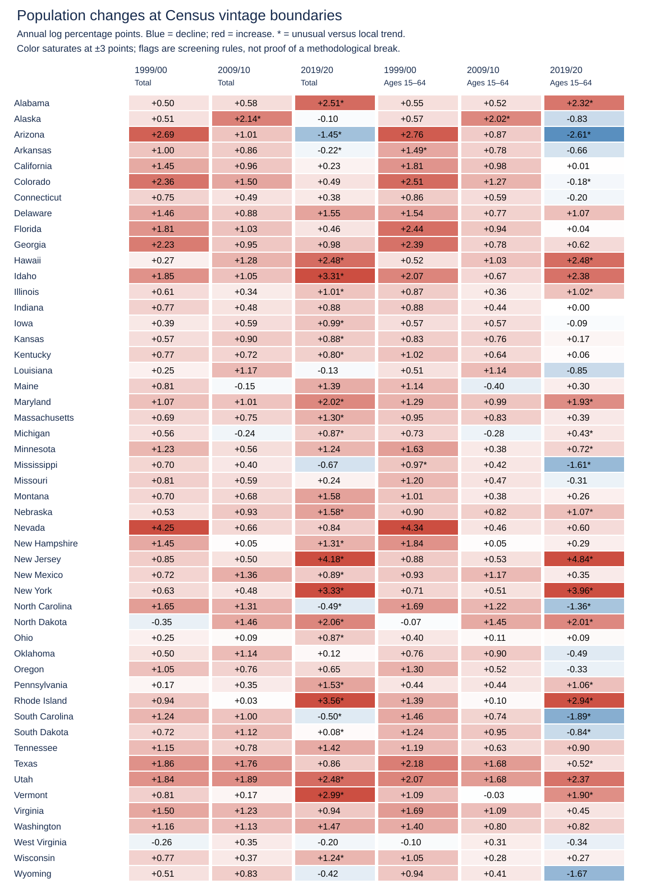
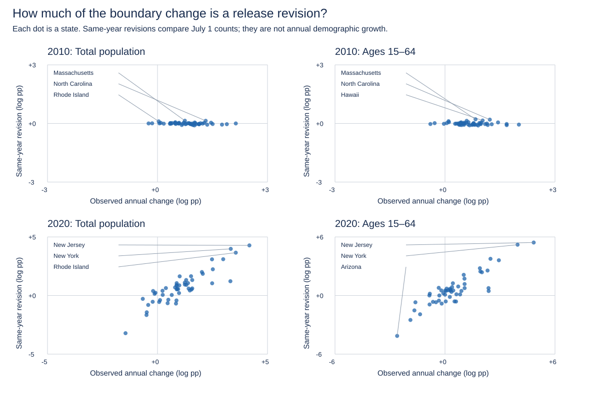

# Census vintage-boundary audit — October 16, 2026

The **2019/2020 boundary has large, directly measurable release-revision effects**. The 2009/2010 overlap revisions are small. The 1999/2000 boundary has two working-age outlier flags, but the six documented files cannot identify their causes. This is a Census-only audit: no validated GDP panel is available in this checkout and no GDP growth rankings are reported.

## Reproduce

From the repository root, with Python 3.12 (standard library only; do not use `python -O`, which disables source-parser assertions):

```sh
# Explicit acquisition; skips existing cache files:
python tests/check_census_sources.py /path/to/census-cache --download
# Offline calculation, no network and no BEA credential:
python scripts/audit_census_boundaries.py /path/to/census-cache
python -m unittest discover -s tests -p 'test_*.py' -v
```

The audit uses the exact six releases documented in [README_USStates.md](README_USStates.md). Their freshly downloaded SHA-256 hashes match all six fingerprints from the earlier October 16 validation. [source_manifest.json](reports/census_boundaries/source_manifest.json) records URLs, hashes, analysis years and overlap years. Preserve the raw cache for offline reproduction; future upstream changes can be detected by comparing hashes. The population parser was moved unchanged in its validation/calculation logic from `tests/check_census_sources.py` to `scripts/census_sources.py`, with an optional return of validated population counts. The old command remains a compatibility entry point.

This deliberately separate Python audit can run before any BEA acquisition. It neither changes `Main.m`, `Main_USStates.m`, nor any production growth formulas. MATLAB regression tests independently compare the committed annual changes with `usstates.logGrowth` for both denominators and all 50 states.

## Tables and graphics

- [Population panel](reports/census_boundaries/population_panel.csv): 1,450 state-years, integer July 1 resident counts, total and ages 15–64 inclusive.
- [Annual changes](reports/census_boundaries/annual_changes.csv): 2,800 state/year/denominator rows (1998–2025), changes in persons, simple percentages and log percentage points.
- [Boundary diagnostics](reports/census_boundaries/boundary_diagnostics.csv): 300 rows, one for every state × boundary × denominator; local benchmark, outlier flag, overlap counts and exact decomposition.
- [Boundary summary](reports/census_boundaries/boundary_summary.csv): six boundary/denominator summaries. Empty overlap fields mean unavailable, **not zero**.





The figures are reproducible SVGs requiring no plotting package. Scatter dots have state-name tooltips; the three largest absolute revisions per panel are labeled. The heatmap prints exact rounded values even beyond its color limits.

## Method and interpretation

Annual log change is `100*log(P[t]/P[t-1])`; simple change is `100*(P[t]/P[t-1]-1)`. All rates below are **log percentage points**, not simple percent changes.

For each state and denominator, compare boundary growth with the median of up to three preceding and three following annual growth rates, excluding all boundary-crossing intervals. The 2000 boundary has five comparison intervals because the sample begins in 1997; 2010 and 2020 have six. Robust scale is `max(0.1, 1.4826*MAD)` in log percentage points. Flag an unusual change only when the absolute deviation is at least both 0.5 points and three robust scales. These transparent, analyst-chosen screening thresholds are not significance tests, causal estimates or validated detection probabilities. Local rates can change because of migration, births/deaths, cohorts aging into/out of ages 15–64, shocks, and estimation revisions. Lack of a flag does not prove continuity.

The older files contain **July 1 `POPESTIMATE2010` and `POPESTIMATE2020`**, although the main pipeline ends those releases at 2009 and 2019. Reading those additional columns with the same age/sex/race filters provides a stronger diagnostic:

```
100 log(P_new[t] / P_old[t-1])
 = 100 log(P_old[t] / P_old[t-1]) + 100 log(P_new[t] / P_old[t])
       within-old-release growth             same-year revision
```

The second term compares the **same date** under two releases. It cannot represent population movement between those dates; it identifies a release/base/methodology revision component. It does not isolate which Census methodological change caused it. The first term is consistent with demographic change under the old release, but remains an estimate, not ground truth. Census explains that new releases revise the series back to the last census; see its [official methodology archive](https://www.census.gov/programs-surveys/popest/technical-documentation/methodology.html). We do not use April 1 census counts or estimate-base columns as annual July 1 observations.

A same-year revision of absolute size at least 0.5 points is labeled `material_same_year_revision`, independently of the local outlier flag. Smaller revisions are labeled `small_same_year_revision`, which does not prove the observed annual change is demographic. The 1990s files in the documented six-file set contain only 1997–1999, so 2000 overlap fields are unavailable; flagged cases remain `unresolved_outlier`. No automatic correction or smoothing is applied.

## Findings

| Boundary | Denominator | Unusual annual changes / 50 | Same-year revisions ≥0.5 points / 50 |
|---|---|---:|---:|
| 1999/2000 | Total | 0 | Unavailable |
| 1999/2000 | Ages 15–64 | 2 | Unavailable |
| 2009/2010 | Total | 1 | 0 |
| 2009/2010 | Ages 15–64 | 1 | 0 |
| 2019/2020 | Total | 27 | 38 |
| 2019/2020 | Ages 15–64 | 20 | 38 |

- **2000:** Arkansas and Mississippi working-age growth are flagged (1.492 and 0.973 points; deviations from local medians of 0.628 and 0.506). Without overlap evidence these could reflect age composition, demographic movements or methodology. Nevada's much larger total growth of 4.251 points is close to its local median of 3.870 and is not flagged: large growth alone is not evidence of a break.
- **2010:** Alaska is the sole flagged state for both measures. Its total growth is 2.136 points with a same-year revision of −0.0004; working-age growth is 2.015 with revision −0.060. The rise is already present within the old release and is therefore plausibly demographic rather than primarily caused by this splice. The largest absolute revisions anywhere are 0.140 points total and 0.213 working age, both Massachusetts.
- **2020:** revisions are large and vary in sign, so neither a common adjustment nor merely excluding a few outliers resolves the issue. In 38 states for each denominator, the absolute same-year revision exceeds 0.5 points. These are counts by denominator, not necessarily identical sets of states.

| State, 2019/2020 | Denominator | Observed change | Within-old-release growth | Same-year revision |
|---|---|---:|---:|---:|
| New Jersey | Total | +4.177 | −0.100 | +4.277 |
| New Jersey | Ages 15–64 | +4.838 | −0.587 | +5.425 |
| New York | Total | +3.330 | −0.651 | +3.982 |
| Arizona | Total | −1.453 | +1.761 | −3.214 |
| Arizona | Ages 15–64 | −2.611 | +1.525 | −4.135 |
| Minnesota | Total | +1.242 | +0.306 | +0.936 |
| Minnesota | Ages 15–64 | +0.721 | −0.202 | +0.924 |

Rounding can make displayed components differ by 0.001 from their sum. The exported unrounded decomposition is checked to 1e−10 points. For a fixed GDP numerator, a population revision enters per-person log growth with the **opposite sign**. For example, New Jersey's +5.425-point working-age revision contributes −5.425 points to measured 2019–2020 GDP-per-working-age growth relative to the old-denominator bridge. This is a denominator identity, **not an estimate of actual GDP growth**.

## Which economic statistics change?

For `q[t]=Y[t]/P[t]` and `T=endYear-startYear`, mean annual log growth is

```
mean(diff(log(q))) = (log(q[end])-log(q[start])) / T.
```

| Statistic | Effect of changing only interior observations, keeping endpoints fixed |
|---|---|
| Full-period mean log growth | Unchanged: intermediate terms telescope |
| Full-period cumulative growth, geometric mean/CAGR | Unchanged: depend only on endpoints |
| Full-period growth rankings, including rank differences between denominators | Unchanged if each state's relevant endpoints remain fixed |
| Individual annual changes, volatility, correlations, arithmetic mean of annual simple growth | Can change |
| Intermediate index trajectories, trend regressions, subperiod growth/rankings | Can change, especially when an affected observation becomes a subperiod endpoint |

**The fixed-endpoint qualification matters.** A revision that changes the final level, including a permanent rescaling after a splice, changes full-period growth by `-log(c)/T` for a population scaling factor `c`. The 1997 and 2025 endpoints themselves come from different releases. Telescoping does not certify that their levels are comparable or that full-period ranks are empirically valid. Omitting the three boundary growth rates and averaging the rest creates a different statistic with a different time coverage; it is not the original full-period CAGR and is not a harmonized series.

## GDP status and next empirical comparison

No validated real GDP observations were present; the prior inactive sample credential is not a basis for economic findings. Accordingly this audit makes **no GDP-based ranking comparison**. Synthetic test data are never used as empirical results.

Once a validated archived `USStatesData.mat` covers all years, run:

```matlab
Main_USStates(1997,1999,[],fullfile('output','states_1997_1999'));
Main_USStates(2000,2009,[],fullfile('output','states_2000_2009'));
Main_USStates(2010,2019,[],fullfile('output','states_2010_2019'));
Main_USStates(2020,2025,[],fullfile('output','states_2020_2025'));
```

Compare both per-resident and per-working-age growth magnitudes and ranks across these Census-consistent segments. Their lengths are 2, 9, 9 and 5 annual intervals; their business-cycle coverage differs, so rank changes are not by themselves causal evidence of splice bias. A further comparison should use alternative harmonized intercensal estimates and fixed GDP vintages over the **same years**. Component-of-change data and a 2000 overlap reconstruction are needed to resolve the remaining demographic explanations. The 2020 pandemic also makes a local smooth-trend assumption especially imperfect.
